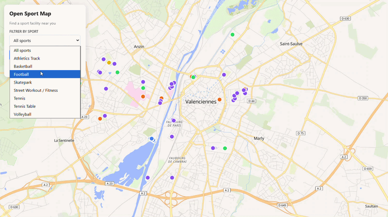

# Open Sport Map

> **An interactive open-source platform to find free outdoor sports facilities around you (street workout, basketball courts, soccer pitches, running tracks).**

- **Data Source :** 
  - OpenStreetMap [Overpass API](https://wiki.openstreetmap.org/wiki/Overpass_API)
- **Base Spatiale :**<br>
  - [](https://postgis.net/)
- **Backend :**<br>
  - [](https://www.python.org/)<br>
  - [](https://fastapi.tiangolo.com/)
- **Frontend (Web):**<br>
  - [](https://maplibre.org/maplibre-gl-js/docs/)

---

## What is Open Sport Map?

Finding accessible, free-to-use outdoor public sports facilities is often frustrating: data is fragmented, commercial apps focus on paid fitness clubs, and open data portals lack intuitive visual interfaces.

**Open Sport Map** solves this problem by combining open geographical data with a modern interactive map:
* **Locate nearby spots instantly** using your browser's geolocation.
* **Filter by sport category** (basketball, soccer, calisthenics / street workout, running).
* **Check facility details** (surface type, night lighting, ground access).

---

## Demo Preview

<center>



</center>

---

## How it Works

The project connects three core software layers into an automated pipeline:

| Layer | Technology | Role |
|---|---|---|
| **Data Extraction (ETL)** | Python, Overpass API | Extracts and standardizes open geographic data from OpenStreetMap. |
| **Spatial Database** | PostgreSQL 16 + PostGIS (Docker) | Stores points with native spatial indexes (GiST) for millisecond proximity lookups. |
| **Backend API** | FastAPI, Uvicorn | Exposes REST endpoints serving RFC 7946 standard GeoJSON. |
| **Web Mapping** | MapLibre GL JS | GPU-accelerated client-side vector map with instant viewport querying. |

---

## Project Roadmap

V1 <br>
- [x] OpenStreetMap automated ETL pipeline (Valenciennes area)
- [x] PostgreSQL/PostGIS spatial indexing & storage
- [x] Python FastAPI endpoints (`/nearby` radius lookup, `/bbox` viewport filtering)
- [x] Web Map (MapLibre GL JS)
- [x] Search by location
- [x] Sport filters<br>

V1.5<br>
- [ ] Extend data to all of France
- [ ] Ingestion of the French National Sports Census (*Data RES*)
- [ ] Spatial deduplication and merging algorithms
- [ ] POI filtering (no more private POI)<br>
- [ ] Search by address

V2<br>
- [ ] Add more European countries
- [ ] Add more Worldwide countries

---

## [Technical Documentation](docs/ARCHITECTURE.md) (click on the title!)


## Local Setup

### 1. Prerequisites
- [Docker Desktop](https://www.docker.com/) installed and running
- Python 3.11+ installed

### 2. Environment Setup
```powershell
python -m venv .venv
.venv\Scripts\Activate.ps1
pip install -r requirements.txt
```

### 3. Spatial Database (PostGIS)
```powershell
# Launch the container (mapped to host port 5433)
docker compose up -d

# Initialize schema and spatial index
Get-Content backend/sql/init.sql | docker exec -i open_sport_map_db psql -U spotter -d open_sport_map
```

### 4. Data Extraction & Ingestion Pipeline
```powershell
python data/scripts/fetch_osm_data.py
python data/scripts/clean_osm_data.py
python data/scripts/load_geojson_to_postgis.py
```

### 5. Running the Backend API (FastAPI)
```powershell
uvicorn backend.app.main:app --reload --port 8000
```
- API Base URL: `http://127.0.0.1:8000`
- Interactive OpenAPI Docs (Swagger UI): `http://127.0.0.1:8000/docs`

### 6. Running the Frontend (MapLibre Web Map)
In a separate terminal:
```powershell
cd frontend
python -m http.server 3000
```
Open your browser at: **`http://localhost:3000`**
